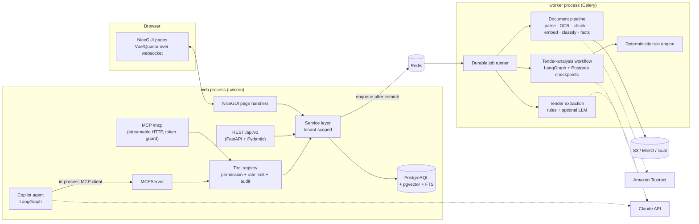
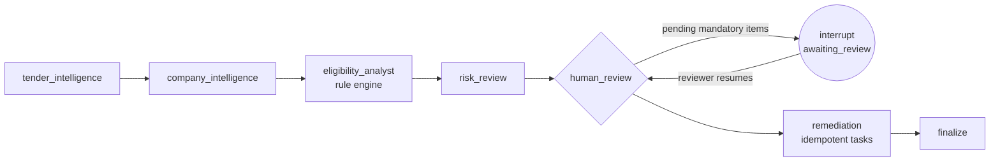

# Architecture

TenderPilot AI is a **modular monolith** (one Python codebase, one database) deployed as separately scaled
processes: `web` (FastAPI + NiceGUI + MCP over HTTP), `worker` (Celery), `beat` (scheduler) and one-off `migrate`.

## Layers

| Layer | Package | Notes |
|---|---|---|
| Interface | `app/ui`, `app/api/v1`, `app/mcp/server` | No business logic; every call goes through services with a `TenantContext`. |
| Identity | `app/auth` | `TenantContext` (user, org, role, scopes) resolved server-side from session cookie or API token. RBAC matrix in `permissions.py`. |
| Services | `app/services/*` | Organizations, documents, tenders, eligibility, evidence, bids, BOQ, analytics, notifications, billing. All queries filter by `organization_id` explicitly. |
| Intelligence | `app/extraction`, `app/ai` | Parsers, normalisation, classification, fact extraction, chunking/embeddings/hybrid retrieval, LLM gateway, LangGraph workflows, copilot, evaluations. |
| Persistence | `app/db` | SQLAlchemy 2 models, Alembic migrations, sync sessions (pinned to UTC). |
| Async | `app/workers`, `app/services/jobs.py` | `processing_jobs` table is the source of truth; Celery only carries job IDs. |
| Storage | `app/storage` | `LocalStorage` (dev, HMAC-signed download URLs) and `S3Storage` (AWS/MinIO, presigned URLs, SSE-KMS). |

## Key flows

**Document ingestion** — upload → content-type sniffing + size/quota checks + heuristic threat scan → (ZIP: safe
expansion) → object stored under `org/<org_id>/<scope>/<uuid>/<name>` → `documents` + immutable `document_versions` row →
`document.process` job → pages (text + block bboxes, tables, OCR when enabled) → structure-aware chunks with
embeddings (copied from an identical-hash version when available) → classification with confidence → facts
(certifications, turnover, projects, registrations, products) with page/verbatim source → earlier versions' facts
marked *superseded* (never deleted).

**Tender analysis** — when all tender documents are processed, `tender.extract` runs rule-based extraction (and the
LLM extractor when configured, on selected pages only, with verbatim-quote verification). Requirements are versioned
per tender version. An assessment (`eligibility.assess`) runs the LangGraph workflow:

**Corrigenda** — a corrigendum upload creates a pending amendment; once processed, fields and requirements are
re-extracted, matched by requirement identity, changed requirements get new rows (old rows `is_current=false`,
`superseded_by_id`), a new `tender_versions` snapshot is stored, affected bid tasks are created, approvals are reopened
per org policy, and a re-assessment is queued.

## Design decisions (and why)

* **Sync SQLAlchemy everywhere** — one code path for API, UI, workers and agents; FastAPI runs sync endpoints in a
  threadpool. Async is used only where libraries require it (MCP client, copilot).
* **Rule engine decides, models assist** — LLMs extract and summarise; eligibility statuses come from deterministic
  Decimal/date logic. `machine_status` is immutable; reviewers can override `status` with an audited justification.
* **Facts as typed tables** — the spec's `evidence_claims` are realised as typed `company_*` tables with a shared
  provenance mixin, giving queryable values (Decimal, dates) instead of opaque JSON.
* **Roles in code** — the role→permission matrix is versioned code (`app/auth/permissions.py`) rather than mutable
  tables, which keeps authorisation reviewable and testable.
* **MCP as the agent boundary** — the copilot calls tools through a real MCP client session, so the same authorisation,
  rate limits and logging apply to internal and external agents.
